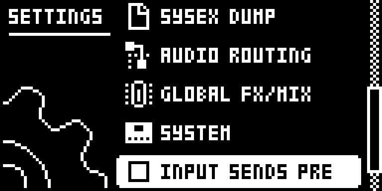
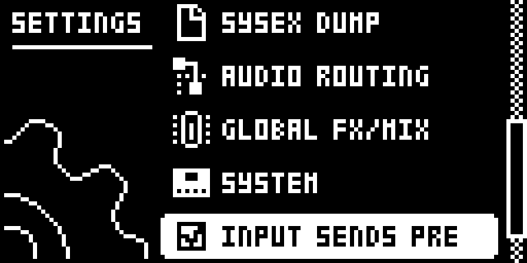
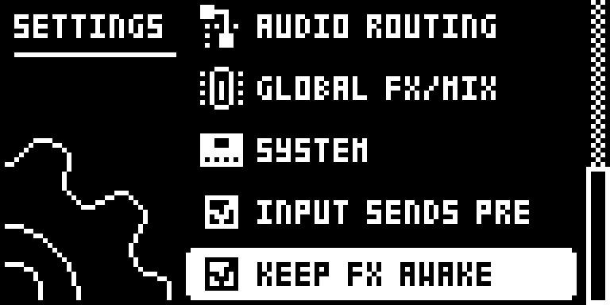

# Input Pre-Fader Sends

## Overview

Stock, the Digitakt takes the delay and reverb sends of the external inputs (IN L and IN R) after their External Mixer LEV. Turning LEV down therefore also turns down what the inputs send to the effects, and at LEV 0 the delay and reverb hear nothing of them.

With **SETTINGS > INPUT SENDS PRE** ticked, the inputs' DEL and REV sends are taken before LEV instead (still after PAN). LEV then sets only the dry inputs on the mains, so at LEV 0 an input goes fully wet: the effects get it, the mains get only the effects' return. The sends are then what stock sends at LEV 127.

Stock, loading a project or pressing STOP twice also puts the delay and reverb on hold: they fade out and stay silent until an audio track trigs, so the inputs get no effect while nothing plays. Elektron describes this as protection against runaway feedback. With **SETTINGS > KEEP FX AWAKE** ticked, the hold releases itself once its fade-out has finished: a double STOP still cuts the effects, and they come back for the inputs within about a second, with no track playing. Together the two rows let the Digitakt work as an effects box for external sources.

Unticked, each row leaves the stock instructions running. Tracks 1-8, DUAL MONO, PAN and every other mixer setting are unchanged in both modes.

Version **0.2.0-experimental** for Digitakt I OS **1.54** on Core 2.1.

## Controls

| Control | Action |
| --- | --- |
| SETTINGS > INPUT SENDS PRE | Ticked: IN L and IN R send to the delay and reverb before their LEV (PRE). Unticked: stock post-fader sends (POST). YES toggles it; RIGHT ticks and LEFT unticks it. Unticked at every power-on. |
| SETTINGS > KEEP FX AWAKE | Ticked: after a project load or a double STOP, the delay and reverb come back by themselves once their fade-out has finished, instead of waiting for a trig. Unticked: stock hold. YES toggles it; RIGHT ticks and LEFT unticks it. Unticked at every power-on. |
| External Mixer DEL, REV, PAN, LEV, DUAL | As stock. In PRE, LEV no longer changes the sends. |
| STOP, STOP | As stock: cuts the delay and reverb. With KEEP FX AWAKE ticked they come back after the fade-out. |

## Usage

The rows are the last two in the stock SETTINGS menu. The External Mixer is the last master page.

### Where to find it

SETTINGS > INPUT SENDS PRE, SETTINGS > KEEP FX AWAKE

1. Use a build containing Input Pre-Fader Sends for the original Digitakt on OS 1.54.
2. Press SETTINGS and go down to INPUT SENDS PRE or KEEP FX AWAKE, the last two rows, with UP/DOWN.
3. Press YES to tick or untick a row. RIGHT ticks it and LEFT unticks it.
4. Press FUNC + LFO until the External Mixer page, and set IN L/IN R LEV, DEL and REV as usual.

### Quick tutorial: the Digitakt as an effects box

1. Connect a source to IN L and IN R, open the External Mixer (FUNC + LFO until its page) and turn the inputs’ DEL or REV up.
2. Open SETTINGS and tick KEEP FX AWAKE. If the effects were on hold, they now answer the inputs within about a second, with no track playing.
3. Tick INPUT SENDS PRE and turn IN L and IN R LEV down to 0: the dry inputs go silent and the delay and reverb get them as if LEV were at full, 100% wet.
4. Raise LEV to blend the dry inputs back in; the sends stay the same. Press STOP twice to cut the effects at any time; with KEEP FX AWAKE ticked they come back by themselves.

## Compatibility and limitations

Requires Core 2.1. Built for OS 1.54 only.

- **Not saved.** Both rows start unticked (stock) at every power-on and apply to every project and pattern. Projects and patterns store nothing for them, so they load the same on a stock OS. After power-on, tick KEEP FX AWAKE (and press STOP twice if the effects stay silent) to release the hold the boot sets.
- **Stock flow change: the effects hold (KEEP FX AWAKE only).** *What changes:* after a project load or a double STOP, the stock firmware keeps the delay and reverb silent until an audio track trigs; with the row ticked they come back by themselves once the hold's fade-out ends. *Why:* used as an effects box for external sources, no track plays, so the effects would stay silent; the stock workaround is a silent trig on a track at volume 0. An own page or gesture was not needed, since the row only decides when the stock hold ends. *What a musician sees:* the double STOP still cuts the effects at once; the inputs' effect returns within about a second. With high delay feedback the inputs can build up again, which the stock hold exists to prevent. *Opt-out:* the row is off at every power-on and unticking it restores the stock hold at once. *Neighbouring flows checked:* the double STOP's cut, project load, and the tracks' own trigs (section 5 of TESTING.md); pattern changes are not tested.
- **After PAN.** PRE sends still follow PAN, as stock sends do; only LEV is bypassed.
- **Louder sends at low LEV.** In PRE the sends equal stock's at LEV 127, so switching to PRE with a low LEV raises the effects' level. The mixer's own smoothing glides the change.
- **With Digi Health and Digi EQ.** On the author's unit, a build with Digi Health and Digi EQ had the input effects awake 5-10 seconds after power-on even without this module; with it, KEEP FX AWAKE behaves as described.
- **What it patches.** Three sites on OS 1.54, all `jsr` patches that return with `rts`: the dry-gain multiply at 0x40071e36 (8 bytes) and the send multiply at 0x40071eb4 (24 bytes) in the render's mixer, and the read of the effects-hold state at 0x40077ef8 (6 bytes) in the audio interrupt. They overlap no other Modwerk module's bytes. The two mixer sites also run from Digi Health's FAST AUDIO copy of the render in SRAM: there is no PC-relative code and no address FAST AUDIO has to relocate in either. Digi EQ's site at 0x400721e6 sits in the same routine, apart.
- **Stock flows.** It adds two SETTINGS rows (`settings:INPUT SENDS PRE`, `settings:KEEP FX AWAKE`) and changes no stock page, gesture or saved data. With both rows unticked the render and the audio interrupt are stock.

## Tests and measurements

See [TESTING.md](TESTING.md) for the exact evidence and the checks still open. The emulator results cover the render's arithmetic, the effects hold and the SETTINGS rows; they do not prove audible output, timing on the unit or behaviour beside every other module on hardware.

## Authorship and licences

draadpiraat: design and code, with Claude Code assistance. Core 2.1, the hook bus and the memory map: irpina (elekloader) and Em D (digikit).
Code: [GPL-3.0-or-later](LICENSE). Screens show Elektron's interface solely to document the modification. No Elektron firmware is included.

## Screens and audio

These captures show the **OS 1.54 build with Core 2.1 and this module alone**, booted in the pinned digiemu with firmware-native drawing. See [capture provenance](media/capture.json) for hashes and panel inputs. No audio demonstration is supplied yet.

Press SETTINGS and go down to INPUT SENDS PRE, below SYSTEM. Unticked, the inputs' sends follow LEV as on the stock OS.

Press YES or RIGHT to tick it. The inputs now reach the delay and reverb whatever their LEV.

KEEP FX AWAKE is the next row down. Ticked, the delay and reverb come back by themselves after a project load or a double STOP.
