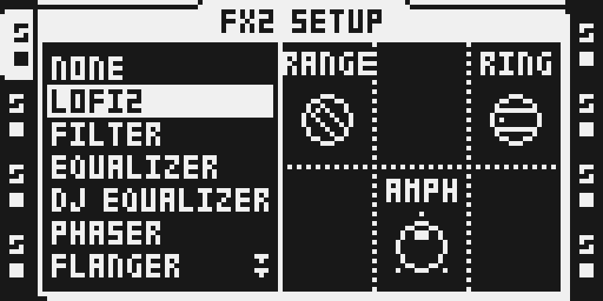

# LOFI2

Bryan T's LOFI2 from [octabam](https://github.com/sambanks/octabam) (`modules/lofi2`), brought into Modwerk with its DSP unchanged. The pinned source is commit `e8665fae3975c68a8b52ba8047c45aef5753a3f7`: the head of his optimisation pull request 704 (414 cycles/sample in SHIFT, down from 654), which was still open upstream on 12 October 2026, on top of the merged LOFI2 (`a6f41a1d`, pull request 657). The author's own README is kept at [upstream/modules/lofi2/README.md](upstream/modules/lofi2/README.md); it holds the design notes and his hardware reports.

**Status: draft import, not released.** It builds natively and passes the author's render gate. This Modwerk build has not run on hardware, has no browser package and is not listed in `sdk/catalog.json`; see [STAGING.md](STAGING.md) for why it is staged in `sdk/drafts/` and what promotion needs.

## Overview

One modulator, ring mod or a stereo frequency shifter, followed by sample-rate and bit reduction on stock LO-FI's curves and a high-shelf cut. LOFI2 is an insert on its own effect ID, so it displaces no stock effect's row: stock LO-FI stays in the chooser beside it.

Signal chain: `dry -> modulator -> MIX -> SRR -> BRR -> LPF -> out`. MIX is the modulator's depth, not a global wet/dry: SRR and BRR run after it and stay live at MIX 0, as they do in stock LO-FI. The defaults (MIX, FREQ, FDBK, SRR, BRR at 0, AMPH at its centre, LPF at 127) are a passthrough.

- **RING** multiplies the track by a parabolic carrier. LOW range is a tremolo, HIGH a sideband generator. AMPH offsets the carrier between left and right.
- **DOWN / UP** shift every partial by FREQ Hz with two Hilbert allpass pairs sharing one oscillator, so the stereo image survives. FDBK feeds the output back for a ladder of shifted copies.
- **SRR / BRR** are the author's own code on stock LO-FI's measured rates and curve, so settings made against stock LO-FI still apply.
- **LPF** is a first-order -12 dB high shelf with no resonance, last in the chain.

Every continuous knob keeps an LFO's fraction between steps and glides to its new value over about 1.5 ms.

## Controls

| Page | Encoder | Name | Range | Default | What it does |
| --- | --- | --- | --- | --- | --- |
| Main | A | FREQ | 0-127 | 0 | Modulator frequency, exponential over six octaves from RANGE's base. RING: 2-130 Hz (LOW), 60-4,000 Hz (HIGH). SHIFT: 2-128 Hz (LOW), 31.25-2,000 Hz (HIGH). 0 is the base frequency, not silence. |
| Main | B | MIX | 0-127 | 0 | Modulator depth: crossfades the ring or shift output against the dry signal. SRR, BRR and LPF still act at MIX 0. |
| Main | C | FDBK / GAIN | 0-127 | 0 | Renamed by MODE. DOWN/UP: FDBK, the shifter's feedback, capped at 0.45. RING: GAIN on the ring product, 0 dB at 0, +6 dB at 64, +11.9 dB at 127. |
| Main | D | SRR | 0-127 | 0 | Sample-rate reduction at stock LO-FI's rates: none through 7, 8,018 Hz at 64, 3,564 Hz at 127. |
| Main | E | BRR | 0-127 | 0 | Bit-depth reduction on stock LO-FI's curve, round-to-nearest: about 13.5 bits removed at 64, 20.8 at 127. |
| Main | F | LPF | 0-127 | 127 | High-shelf cut, -12 dB above a corner from 100 Hz (0) to 16 kHz (126). 127 is out of circuit, bit for bit. |
| SETUP | A | RANGE | LOW / HIGH | HIGH | FREQ's range: sub-audio or audio. |
| SETUP | C | MODE | RING / DOWN / UP | RING | Ring modulator, or the shifter moving partials down or up. The knob prints its value as its name. A change ducks the modulator for 5 ms each way. |
| SETUP | E | AMPH | -64..+63 | 0 | Ring carrier's L/R phase offset, -90 to +88.6 degrees. + puts R ahead. RING only. |

## Usage

Quick tutorial: ring, crush and shift a loop.

1. On an audio track that plays a sample, hold FUNC and press FX2, turn LEVEL to LOFI2 and press YES. Nothing changes yet: the defaults are a passthrough.
2. Press FX2 for the main page. Turn MIX (encoder B) to 127 and FREQ (encoder A) to 64: the track is ring-modulated. Raise SRR or BRR (encoders D and E) for sample-rate and bit reduction, and lower LPF (encoder F) from 127 to darken the result.
3. For the frequency shifter, hold FUNC and press FX2 and turn MODE (encoder C) to UP or DOWN; on the main page the third knob is now FDBK. To bypass, set MIX, SRR and BRR to 0 and LPF to 127, or choose NONE in FX2 SETUP.

## Compatibility and limitations

- **Firmware:** Octatrack OS 1.40C. **Effect ID:** `0x09` in Modwerk. octabam uses `0x1f`, which is TapeHead's here, so a project saved with octabam's LOFI2 selects TapeHead's ID on a Modwerk image.
- **Location:** FX2. The module uses no buffer and its author declares it eligible for an FX1 row, but only the FX2 chooser was built and captured in this tree.
- **Size.** 836 program words and a 516-word table on each DSP core, placed as one 1,352-word block. With stock DSP code built in, that is more than any one stock reverb's space:

  | Stock effects given up | Result (native build, both cores) |
  | --- | --- |
  | none, PLATE REV, SPRING REV or DARK REV alone | refused (largest opening 594 / 1,063 / 1,067 words) |
  | PLATE REV + SPRING REV | fits, 305 words free |
  | SPRING REV + DARK REV | fits, 778 words free |
  | Output Matrix + TapeHead + Sidechain Compressor + LOFI2, three reverbs | refused: 2,931 words needed, 2,724 available |
  | the same, three reverbs + CHORUS | fits, 122 words free |
  | the same, three reverbs + LO-FI | fits, 330 words free |
  | any selection with Analog BD | refused by native octabam: LOFI2 is not on Analog BD's DSP companion list |

  A scratch-only probe with Analog BD's companion list widened (not part of this change, unreviewed) placed Analog BD, Output Matrix, TapeHead, Sidechain Compressor and LOFI2 only with the three reverbs, LO-FI, DJ EQ and CHORUS given up, and then only because giving up DJ EQ lets the build move LOFI2's table into X memory. With DJ EQ or CHORUS kept it is refused. That layout has not run anywhere.
- **Cost.** SHIFT counts 414 static cycles/sample and executes 428 instructions/sample at its worst in `dsp_host`, about 1.4x stock SPRING REV's worst case (314) and 1.5x stock LO-FI (290). RING is 274, below SPRING REV. SHIFT is still dearer than every stock effect, which needs the owner's acceptance. On his MKII the author ran this loop on all eight tracks in SHIFT at once, four per core (his octabam build, 12 October 2026). His recommendation: **SHIFT on up to four per core, all eight tracks.** The earlier merged revision (654 cycles) overran core 0 with a fourth instance.
- **On the Modwerk base (USB loading).** LOFI2's relocatable DSP package and a page-less runtime package build on that path, and its 1,352 words fit the base's arena without giving up a stock effect. Cycle admission is on the line: one instance may cost 726 chip cycles and an emulator figure is charged at 7/4. Declared as its static count (414, charged 725) it is admitted; declared as its worst executed trig-split case (429, charged 751) it is refused. Read from the base's source; no install was run. See TESTING.md.
- **No single-knob bypass.** A passthrough is MIX 0, SRR 0, BRR 0 and LPF 127.
- **A missing module.** The native build aliases the ID of a module that is not in the image to NONE, so a project that selects LOFI2 on an image without it should play that track dry. Not tested.
- **Aliasing is intended** in SRR and BRR; they have no reconstruction filter. Stock LO-FI follows its hold with a FIR near Nyquist that LOFI2 does not copy.
- **Not tested in this tree:** hardware, parameter locks, scenes and the crossfader, Part/project reload, reboot persistence, FX1, payload B in the render gate, `fx:audit`, the stress run.

## Tests and measurements

Details, commands and every result are in [TESTING.md](TESTING.md).

- Native build on effect ID `0x09`: 836 + 516 words on both DSP cores.
- The author's render gate, `verify_lofi2.py`: all 48 checks pass, including SRR's rate at five settings and BRR's step at eight settings against stock LO-FI rendered from the tester's own OS 1.40C.
- Dirty-state, init-register, menu, replaces, label and mode-name gates pass on the `lofi2` test remix.
- Static cost 414 cycles/sample; `dsp_host` benchmark 428 instructions/sample (SHIFT) and 274 (RING), against stock SPRING REV 314, LO-FI 290, DARK REV 242 and DJ EQ 331.
- Elekloader path: the relocatable DSP package (1,352 words, 4 relocations) and a private page-less runtime package build; the base's cycle rule admits or refuses it depending on which figure is declared (read from the source, not run).
- Upstream hardware evidence (Bryan T's MKII, octabam images 96-99 and build 11, October 2026) is quoted in TESTING.md. It is not evidence for this build.

## Authorship and licences

LOFI2 was designed and written by **Bryan T** ([bryantysinger](https://github.com/bryantysinger)): the DSP code, tables, declaration, render gate and hardware testing. It was contributed to octabam (Sam Banks, MIT), whose SDK it is written against, and is distributed under octabam's MIT licence; the full text is in [LICENSE](LICENSE) and, byte for byte, in [upstream/LICENSE](upstream/LICENSE).

What Modwerk changed, all recorded in `sdk/imports/lofi2-e8665fa.json`:

- `lofi2.asm`: unchanged.
- `manifest.py`: effect ID `0x1f` to `0x09` (TapeHead holds `0x1f` here), placement priority 15 to 19 (after every effect already listed, so no existing module moves), the gate's path, and the comments that say so. Layout letter `F` is kept; it is free here.
- `verify_lofi2.py`: moved from `tools/verify/` into the module folder (one path line), and its scratch image is built by the script itself, LOFI2 alone with fallback NONE, because this tree has no SEND module for octabam's `audition` helper to pair it with. The 48 checks and their limits are unchanged.
- The author's originals of both files, his README, his test remix and the licence are kept unchanged under `upstream/`.

No Elektron firmware, extracted stock code or tables are included. Stock LO-FI's rates and curve are the author's measurements, expressed as formulas in `manifest.py`.

## Screens and audio

Real LCD captures from the headless emulator on a private native build (image SHA-256 `43e110ff…21b24e`), 12 October 2026. They show the interface, not hardware behaviour or sound.

1. 
   Hold FUNC and press FX2, turn LEVEL to LOFI2 and press YES. SETUP shows RANGE, MODE (printing RING) and AMPH.
2. 
   The main page at its defaults, a passthrough.
3. 
   MIX 127 and FREQ 64: full ring modulation.
4. 
   MODE turned to UP for the frequency shifter.
5. 
   In DOWN or UP the third knob is FDBK.

There is no audio preview.
