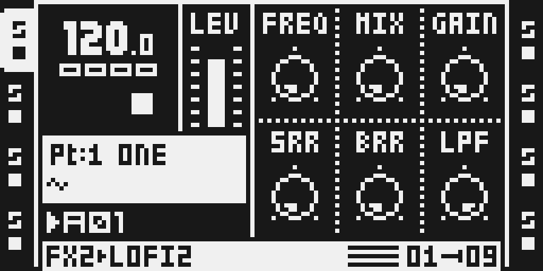
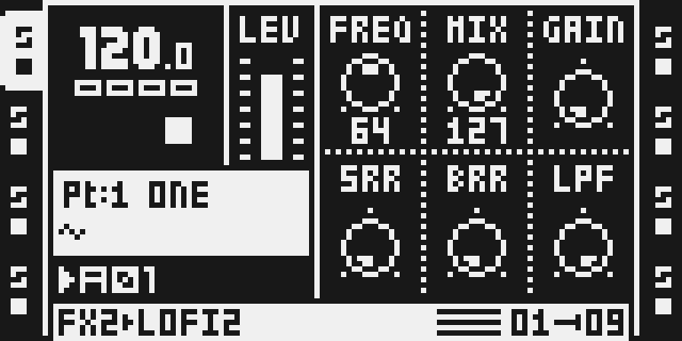
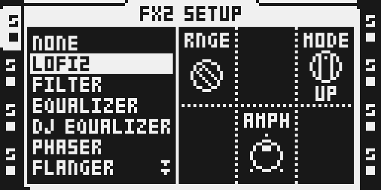
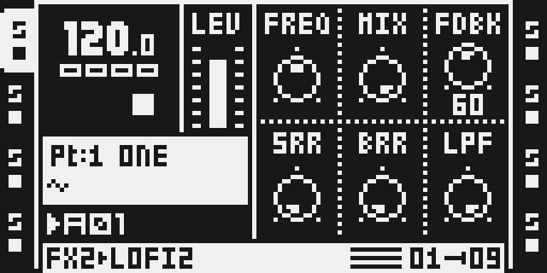

# LOFI2

Bryan T's LOFI2 from [octabam](https://github.com/sambanks/octabam) (`modules/lofi2`), brought into Modwerk with its DSP unchanged. The pinned source is commit `8250be0c23ca0a0a953cb7e5721e3bdb98dadfe5` on upstream `main`: the merged LOFI2 (pull request 657) with the author's optimisation (pull request 704, merged 13 October 2026; 416 cycles/sample in SHIFT, down from 654) and his SHIFT fix of 14 October 2026 (`153063d8`: the Hilbert coefficients squared, so the unwanted sideband drops from about -20 dB to about -46 to -55 dB, with the same instructions and cycles). The author's own README is kept at [upstream/modules/lofi2/README.md](upstream/modules/lofi2/README.md); it holds the design notes and his hardware reports.

**Status: release candidate, not released.** It builds natively, passes the author's render gate (70 checks), a stress run and the performance audit, and its packages compile. This source's USB package ran on an Octatrack MKII for about 15 minutes beside five other modules: every mode, the fixed SHIFT by ear, two instances on one core and a third refused; the base's self-test failed on ColdFire CPU with the six modules (98.8 %; see below). The previous source (`21f6de90`, the unsquared coefficients), which differs only in sixteen DSP data words, also ran as a card image and as a USB package with reloads and power cycles ([evidence/hardware.md](evidence/hardware.md)). The owner's first-release approval is still missing.

## Overview

One modulator, ring mod or a stereo frequency shifter, followed by sample-rate and bit reduction on stock LO-FI's curves and a high-shelf cut. LOFI2 is an insert on its own effect ID, so it displaces no stock effect's row: stock LO-FI stays in the chooser beside it.

Signal chain: `dry -> modulator -> MIX -> SRR -> BRR -> LPF -> out`. MIX is the modulator's depth, not a global wet/dry: SRR and BRR run after it and stay live at MIX 0, as they do in stock LO-FI. The defaults (MIX, FREQ, FDBK, SRR, BRR at 0, AMPH at its centre, LPF at 127) are a passthrough.

- **RING** multiplies the track by a parabolic carrier. LOW range is a tremolo, HIGH a sideband generator. AMPH offsets the carrier between left and right.
- **DOWN / UP** shift every partial by FREQ Hz with two Hilbert allpass pairs sharing one oscillator, so the stereo image survives. FDBK feeds the output back for a ladder of shifted copies.
- **SRR / BRR** are the author's own code on stock LO-FI's measured rates and curve, so settings made against stock LO-FI still apply.
- **LPF** is a first-order -12 dB high shelf with no resonance, last in the chain.

Every continuous knob keeps an LFO's fraction between steps and glides to its new value over about 1.5 ms.

## Controls

| Page | Encoder | Name | Range | Default | What it does |
| --- | --- | --- | --- | --- | --- |
| Main | A | FREQ | 0-127 | 0 | Modulator frequency, exponential over six octaves from RNGE's base. RING: 2-130 Hz (LOW), 60-4,000 Hz (HIGH). SHIFT: 2-128 Hz (LOW), 31.25-2,000 Hz (HIGH). 0 is the base frequency, not silence. |
| Main | B | MIX | 0-127 | 0 | Modulator depth: crossfades the ring or shift output against the dry signal. SRR, BRR and LPF still act at MIX 0. |
| Main | C | FDBK / GAIN | 0-127 | 0 | Renamed by MODE. DOWN/UP: FDBK, the shifter's feedback, capped at 0.45. RING: GAIN on the ring product, 0 dB at 0, +6 dB at 64, +11.9 dB at 127. |
| Main | D | SRR | 0-127 | 0 | Sample-rate reduction at stock LO-FI's rates: none through 7, 8,018 Hz at 64, 3,564 Hz at 127. |
| Main | E | BRR | 0-127 | 0 | Bit-depth reduction on stock LO-FI's curve, round-to-nearest: about 13.5 bits removed at 64, 20.8 at 127. |
| Main | F | LPF | 0-127 | 127 | High-shelf cut, -12 dB above a corner from 100 Hz (0) to 16 kHz (126). 127 is out of circuit, bit for bit. |
| SETUP | A | RNGE | LOW / HIGH | HIGH | FREQ's range: sub-audio or audio. |
| SETUP | C | MODE | RING / DOWN / UP | RING | Ring modulator, or the shifter moving partials down or up. The value shows under the knob while it turns. A change ducks the modulator for 5 ms each way. |
| SETUP | E | AMPH | -64..+63 | 0 | Ring carrier's L/R phase offset, -90 to +88.6 degrees. + puts R ahead. RING only. |

## Usage

Assign LOFI2 in FX2 SETUP, shape the modulator on the main page (FREQ, MIX, GAIN or FDBK), then add reduction with SRR and BRR and tame the top with LPF. RNGE, MODE and AMPH are on the SETUP page.

### Quick tutorial: ring, crush and shift a loop

1. On an audio track that plays a sample, hold FUNC and press FX2, turn LEVEL to LOFI2 and press YES. Nothing changes yet: the defaults are a passthrough.
2. Press FX2 for the main page. Turn MIX (encoder B) to 127 and FREQ (encoder A) to 64: the track is ring-modulated. Raise SRR or BRR (encoders D and E) for sample-rate and bit reduction, and lower LPF (encoder F) from 127 to darken the result.
3. For the frequency shifter, hold FUNC and press FX2 and turn MODE (encoder C) to UP or DOWN; on the main page the third knob is now FDBK. To bypass, set MIX, SRR and BRR to 0 and LPF to 127, or choose NONE in FX2 SETUP.

## Compatibility and limitations

- **Firmware:** Octatrack OS 1.40C. **Effect ID:** `0x09` in Modwerk. octabam uses `0x1f`, which is TapeHead's here, so a project saved with octabam's LOFI2 selects TapeHead's ID on a Modwerk image.
- **Location:** FX2. The module uses no buffer and its author declares it eligible for an FX1 row, but only the FX2 chooser was built and captured in this tree.
- **Size.** 838 program words and a 516-word table on each DSP core, placed as one 1,354-word block. With stock DSP code built in, that is more than any one stock reverb's space:

  | Stock effects given up | Result (native build, both cores) |
  | --- | --- |
  | none, PLATE REV, SPRING REV or DARK REV alone | refused (largest opening 594 / 1,063 / 1,067 words) |
  | PLATE REV + SPRING REV | fits, 303 words free |
  | SPRING REV + DARK REV | fits, 776 words free |
  | Output Matrix + TapeHead + Sidechain Compressor + LOFI2, three reverbs | refused: 2,933 words needed, 2,724 available |
  | the same, three reverbs + CHORUS | fits, 120 words free |
  | the same, three reverbs + LO-FI | fits, 328 words free |
  | any selection with Analog BD | refused by native octabam: LOFI2 is not on Analog BD's DSP companion list |

  A scratch-only probe with Analog BD's companion list widened (not part of this change, unreviewed) placed Analog BD, Output Matrix, TapeHead, Sidechain Compressor and LOFI2 only with the three reverbs, LO-FI, DJ EQ and CHORUS given up, and then only because giving up DJ EQ lets the build move LOFI2's table into X memory. With DJ EQ or CHORUS kept it is refused. That layout has not run anywhere.
- **Cost.** SHIFT counts 416 static cycles/sample and executes 430 instructions/sample at its worst in `dsp_host`, about 1.4x stock SPRING REV's worst case (314) and 1.5x stock LO-FI (290). RING is 274, below SPRING REV. SHIFT is still dearer than every stock effect, which needs the owner's acceptance. On his MKII the author ran the previous source (the same instructions) on all eight tracks at once, four per core, in UP, in DOWN and in RING (his octabam build 12, 13 October 2026). His recommendation: **SHIFT on up to four per core, all eight tracks.** The earlier merged revision (654 cycles) overran core 0 with a fourth instance.
- **USB loading.** The Modwerk base loads LOFI2 on demand into FX1 or FX2 of any track. It declares 637 cycles a sample, timed on an MKII with the previous package, whose instructions, addresses and relocations are the same (only sixteen coefficient words differ), against the 726 the base lets one module take: two instances fit on one DSP core when its other slots are free, and a third is refused with DSP FULL. Removing it is refused while a track runs it.
- **A faint residue in SHIFT after the input stops.** In DOWN and UP, once sound has passed through, the output settles at about -83 to -94 dBFS instead of silence and stays there (measured in a `dsp_host` render; RING and the reduction stages return to silence; the previous coefficients left about -77 to -83 dBFS). The upstream module does the same. Turn MIX to 0 or switch MODE to RING to clear the path when a track must be silent.
- **SHIFT can sustain itself at the top of FDBK.** In UP or DOWN with RNGE HIGH, FREQ about 60 to 76 and FDBK 124 or more (DOWN from about 120), the feedback loop does not die away: after the input stops the output keeps a loud tone near full scale (about -4 dBFS in a `dsp_host` render) until MIX, FDBK or FREQ moves. At FDBK 112 and below, every setting measured is at or under -70 dBFS four seconds after the input stops. The previous coefficients did the same at RNGE LOW, FREQ 127. On the contributor's MKII (20 October 2026, package `4f794ebc…`, base `6650236a`) MODE UP, RNGE HIGH, FREQ 64, MIX 127, FDBK 127, SRR 0, BRR 0, LPF 127, a short sound then silence: a tone kept sounding after the input ended; with FDBK turned down to 120 it died away. DOWN, other FREQ values and the previous coefficients were not tried on the unit, and the level was not measured. The code caps the feedback at 0.45 and its comment says the loop settles at 0.5/(1-fdbk), inside the rail, so this may not be intended; it is asked upstream as a question in [octabam issue 825](https://github.com/sambanks/octabam/issues/825). The upstream module does the same.
- **High BRR silences quiet signals.** The quantiser rounds to the nearest step, so at BRR 127 anything that peaks below about 0.11 of full scale comes out as silence; stock LO-FI does the same at the same level. On a quiet track, or on the master track after a quiet mix, lower BRR or raise the level going in.
- **No single-knob bypass.** A passthrough is MIX 0, SRR 0, BRR 0 and LPF 127.
- **A missing module.** The native build aliases the ID of a module that is not in the image to NONE, so a project that selects LOFI2 on an image without it should play that track dry. Not tested on a card image. Over USB, the base shows MODULE MISSING and plays the track dry, and reinstalling LOFI2 restores it with its settings (tested on an MKII).
- **Aliasing is intended** in SRR and BRR; they have no reconstruction filter. Stock LO-FI follows its hold with a FIR near Nyquist that LOFI2 does not copy.
- **Parameter locks hold until the track's next trig**, as they do for every stock parameter on this OS (checked against the stock image in the emulator).
- **The base's self-test with six modules failed on CPU.** On an MKII on the uncached beta base `6650236a`, with LOFI2 beside Output Matrix, Analog BD, Apply Scene, Quantize Live Rec and one private module, the self-test reported the ColdFire CPU at 98.8 % ("the CPU over 90 % (LOFI2)"); every module was intact and the DSP effects ran, and the tester noticed no lag during the session (an impression, not a measurement). LOFI2 has no ColdFire code, and six or seven modules on an uncached base reach 80-100 % CPU in other testers' sets too, but the cause was not confirmed.
- **Scene locks hold LOFI2's knobs** as they hold any parameter: if FREQ, MIX, GAIN or SRR seem to do nothing, check the track's scene locks.
- **Not tested:** on this source, BRR and LPF individually on a unit, the feedback case in DOWN or at other FREQ values on a unit, reloads and a power cycle (run with the previous source only); eight instances and scenes on a unit; FX1 in a card image on a unit; payload B in the render gate.

## Tests and measurements

Details, commands and every result are in [TESTING.md](TESTING.md).

- Native build on effect ID `0x09`: 838 + 516 words on both DSP cores.
- The author's render gate, `verify_lofi2.py`: all 70 checks pass, including the shifter's sidebands in UP and DOWN at 1, 3, 5, 10 and 15 kHz and two block lengths, the unwanted one under -40 dB (measured -45.7 to -56.2 dB; the previous source fails 21 of them at -18.7 to -30.7 dB), SRR's rate at five settings and BRR's step at eight settings against stock LO-FI rendered from the tester's own OS 1.40C.
- Dirty-state, init-register, menu, replaces, label and mode-name gates pass on the `lofi2` test remix.
- Static cost 416 cycles/sample; `dsp_host` benchmark 430 instructions/sample (SHIFT) and 274 (RING), against stock SPRING REV 314, LO-FI 290, DARK REV 242 and DJ EQ 331.
- Stress: eight instances (four per core) behind DJ EQ, LFOs and every slot changing each sixteenth, 32 s under memory guards: no hang, no clobber. `perf:audit` passes with a justification for SHIFT's cost.
- `fx:audit`: clean at the defaults and with the shelf in; the modulating and reducing settings are recorded as intended; the SHIFT residue and the self-sustaining feedback above are the findings.
- USB loading, this source (package `4f794ebc…`, 20 October 2026): install and Keep, every mode, FREQ, MIX, GAIN and SRR, the fixed SHIFT by ear, two instances on one core and a third refused DSP FULL, on base `6650236a` beside five other modules; the base's self-test failed on CPU (above).
- USB loading, previous source (package `7ee9277f…`): ran on an MKII on the beta base: trial and Undo, install and Keep, FX1 and FX2 on both cores, two instances on one core, removal, the missing-module fallback and persistence through a Part reload, a project reload and a power cycle.
- Hardware (previous source, card image `3d63406d…`): a functional MKII report (every mode, five SHIFT instances, a parameter lock, Part reload and a power cycle). Not repeated with this source.
- Upstream hardware evidence (Bryan T's MKII, octabam images 96-99 and builds 11 and 12, October 2026) is quoted in TESTING.md. It is not evidence for this build.

## Authorship and licences

LOFI2 was designed and written by **Bryan T** ([bryantysinger](https://github.com/bryantysinger)): the DSP code, tables, declaration, render gate and hardware testing. It was contributed to octabam (Sam Banks, MIT), whose SDK it is written against, and is distributed under octabam's MIT licence; the full text is in [LICENSE](LICENSE) and, byte for byte, in [upstream/LICENSE](upstream/LICENSE).

What Modwerk changed, all recorded in `sdk/imports/lofi2-8250be0.json`:

- `lofi2.asm`: unchanged.
- `manifest.py`: effect ID `0x1f` to `0x09` (TapeHead holds `0x1f` here), the native author field from "Bryan T" to his GitHub handle (the package compiler matches it against this manifest), two panel changes after the first run on a unit (RANGE is named RNGE, because the five letters overran the name field, and MODE is a name select, so it keeps its name where octabam prints the value in the name field and again beneath it), placement priority 15 to 19 (after every effect already listed, so no existing module moves), the gate's path, and the comments that say so. Upstream's two empty DOWN and UP mode views (`947fe57a`, for octabam's MODE DEFAULTS gate) are not carried: they rename nothing. Layout letter `F` is kept; it is free here.
- `perf.py` and `evidence/performance.json` are Modwerk's own (benchmark and stress harness, after E-Verb's); they are not part of the author's module.
- `verify_lofi2.py` also gets one alias line so its checks can keep octabam's word RANGE.
- `verify_lofi2.py`: moved from `tools/verify/` into the module folder (one path line), and its scratch image is built by the script itself, LOFI2 alone with fallback NONE, because this tree has no SEND module for octabam's `audition` helper to pair it with. The checks and their limits are unchanged.
- The author's originals of both files, his README, his test remix and the licence are kept unchanged under `upstream/`.

No Elektron firmware, extracted stock code or tables are included. Stock LO-FI's rates and curve are the author's measurements, expressed as formulas in `manifest.py`.

## Screens and audio

Real LCD captures from the headless emulator on a private native build of the previous source (image SHA-256 `3d63406d…0678e2`), 13 October 2026. This source's image differs from it only in the sixteen DSP coefficient words, so the pages and labels are the same. They show the interface, not hardware behaviour or sound.

1. 
   Hold FUNC and press FX2, turn LEVEL to LOFI2 and press YES. SETUP shows RNGE, MODE and AMPH.
2. 
   The main page at its defaults, a passthrough.
3. 
   MIX 127 and FREQ 64: full ring modulation.
4. 
   MODE turned to UP for the frequency shifter.
5. 
   In DOWN or UP the third knob is FDBK.

There is no audio preview.
