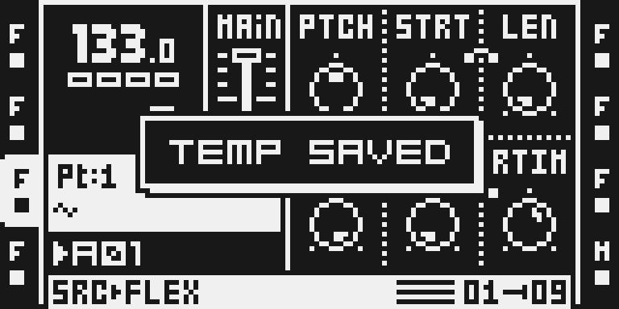
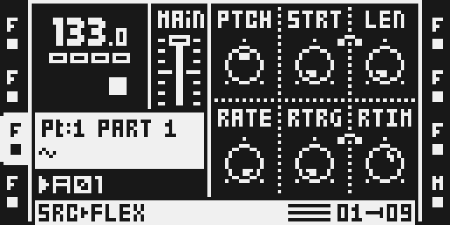
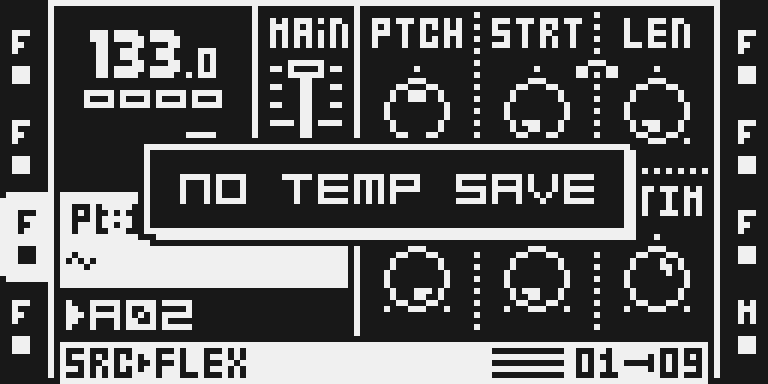

# Temp Save

Version: 0.1.0-experimental · author: Nathaniel Pavel (@npp1993)

## Overview

Got a groove you like? On the pattern screen, press FUNC + YES to keep a temporary copy of the active pattern and its whole Part, scenes included. Experiment freely, then press FUNC + NO to put both back at once, even while the sequencer plays. It works like Temp Save and Reload on the Digitakt and Digitone.

The copy is separate from everything the Octatrack already keeps. Your saved Part stays your saved Part, so RELOAD PART (FUNC + CUE) still goes back to your last Part save. Copied patterns and tracks stay on the clipboard. Nothing is written to the card.

**Hardware status.** Tested by hand on one MKII over USB on 28 October 2026 (save, reload, parameters, a machine change, playback, other patterns, a Part change, menus, sample preview, stock YES/NO and FUNC + CUE). The MKI and the card build have not run on a unit. Details: [TESTING.md](TESTING.md) and [evidence/hardware.md](evidence/hardware.md).

## Controls

| Gesture | Where | What it does |
|---|---|---|
| FUNC + YES | the pattern screen, no menu or list open | Keeps a copy of the active pattern and the Part it plays. The screen shows TEMP SAVED. A second FUNC + YES replaces the copy. |
| FUNC + NO | the same | Puts the copy back: the pattern and its Part as they were at FUNC + YES. The screen shows RELOADED. |
| FUNC + NO | on another pattern, bank or project | Shows NO TEMP SAVE and changes nothing. |

There is no page, menu row or knob. The copy lives in the module's memory and is gone after a power-off.

## Usage

Press FUNC + YES whenever you reach something worth keeping, then experiment. FUNC + NO takes you back to that moment; press FUNC + YES again to move the restore point forward. Use it while the sequencer plays: the reload is immediate.

### What the copy holds

- **The pattern:** every track's trigs, trig conditions, parameter locks, length and scale settings.
- **The whole Part the pattern plays:** machines, every page of every track, both effects, and the scenes with their locks.

### What a reload leaves alone

- The crossfader position, the selected scenes and the scene mutes: they stay where your hands left them, and the restored scenes play from there.
- Track mutes.
- The saved Part (what RELOAD PART returns to) and the clipboard.
- The other Parts and patterns of the bank.

After FUNC + NO the Part counts as edited, as after a paste: save the Part and the project to keep the result.

If you moved the pattern to another Part after FUNC + YES, FUNC + NO brings back the Part it had, along with that Part's settings.

### What changes in a stock flow

**FUNC + YES and FUNC + NO on the pattern screen.** On the stock OS these do exactly what YES and NO alone do there (ARM ALL, DISARM ALL), so the module takes them for the temp save; YES and NO alone are unchanged. A quick second press while TEMP SAVED or RELOADED still shows saves or reloads again, rather than reaching stock's double-press ARM TRACK / DISARM TRACK. Everywhere else both gestures stay stock: in menus and windows (MIXER, PROJECT, PART, SETUP pages, PATTERN SETTINGS), in sample lists (FUNC + YES still previews), and in the one panel mode where YES and NO alone do nothing. This applies only while the module is installed. Checked side by side: YES, NO, FUNC + CUE, the sample preview, the menus above and Apply Scene's SCENE + YES.

## Quick tutorial

1. On the pattern screen, with no menu open, place a few trigs and press FUNC + YES: TEMP SAVED.
2. Change the pattern and the Part: clear some trigs, turn knobs on two pages, try another machine.
3. Press FUNC + NO: RELOADED. The trigs, knobs and machine are back as they were at step 1.
4. To keep the result, save the Part (FUNC + PART, SAVE) and the project.

## Compatibility and limitations

- OS 1.40C, MKI and MKII (both models send FUNC + YES and FUNC + NO to the same stock handlers); tested by hand on an MKII only.
- One copy at a time, of one pattern and its Part. It is gone after a power-off and never written to the card.
- The reload replaces the pattern and the Part as a whole, including edits since FUNC + YES on any track.
- Saving the project under another name, or loading another project, makes the copy unusable (NO TEMP SAVE); reloading the same project keeps it.
- Memory: 816 bytes of code and a 42,892-byte buffer (one pattern and one Part). Over USB that comes out of the module pool shared by all modules (256 KB).
- No DSP code, no effect slot, no saved data. Installs beside every other module: patches two stock sites nobody else patches, separate from Apply Scene's YES site.

## Tests and measurements

[TESTING.md](TESTING.md) has every command and result. In short: an emulator gate (`verify.py`, 37 checks on the MKII panel, 34 on the MKI) compares the pattern and Part byte for byte after each reload; a hand test on one MKII passed every step after one fix. A save runs about 16,000 ColdFire instructions, a reload about 640,000 (most of it stock's own Part reload and screen refresh), measured in the emulator, not timed on the unit.

## Authorship and licences

Original work by Nathaniel Pavel (@npp1993), MIT ([LICENSE](LICENSE)). The idea follows the Temp Save and Reload gestures of Elektron's Digitakt and Digitone; no code, firmware or artwork from them is used. Stock routines are called by address only; no Elektron bytes are in this folder.

## Screens and audio

Real LCD captures from the emulator ([media/capture.json](media/capture.json)):

No audio: the module makes no sound of its own.
